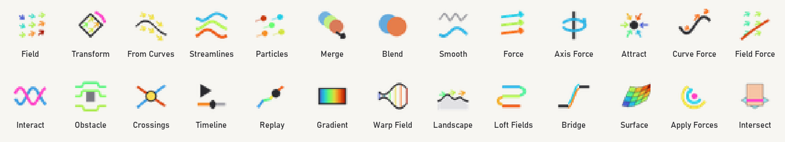

# groundtrack for Grasshopper

Movement data in Grasshopper (Rhino 8): flow fields, streamlines, a particle system like Houdini's
POP network, blending, crossings, replay of the real tracks, and a timeline with recording.

It reads the results of [groundtrack](https://github.com/LCS3002/groundtrack), which turns video of
people and vehicles into tracks and flow fields in metres (British National Grid). Every output is
plain Grasshopper geometry: curves, points, vectors and meshes. So Move, Rotate, Curve|Curve,
Tween, Bake and everything else work on it.



## Components (tab "groundtrack")

| | Component | What it does |
|---|---|---|
|  | **Field** | Loads a field from your results. **Site / Clip / Group** come as dropdowns: the whole site (all clips combined) or one clip, and people, vehicles, cycles, buses or all. Optional **Time**: just the movement around that moment, from the tracks. Move / Rotate / Scale it like geometry. |
|  | **Streamlines** | Evenly spaced flow lines through a field, coloured by speed. One **Density** slider. |
|  | **Particles** | POP-like: particles are born where people or vehicles were (busier places more), follow the field and die outside it. Settings: rate, life, speed, noise, trail. Points, velocities, trails and colours come out. Driven by a Timeline (scrub back and forth), or **Run**. |
|  | **Blend Fields** | Layer or interpolate fields, also from different sites. A **T** slider runs from the first field to the last; Weights are optional. |
|  | **Crossings** | Where two sets of curves cross (e.g. people vs vehicles, or two sites laid over each other), at what angle, plus a heat map. |
|  | **Timeline** | One clock (seconds) for Particles, Replay and time-sliced Fields. Double-click it to open the timeline window: play / pause, scrub, speed, loop, in / out, and **Record**, which saves the Rhino viewport as a PNG sequence. |
|  | **Replay** | The real tracks at time T: everyone's position and trail, coloured by speed. It follows its field when you move it. |

The colours are the groundtrack ramp from blue (slow) to red (fast). Each group has its own scale:
people 0–2.5 m/s, vehicles 0–15 or 0–35 m/s. Right-click a component and choose **Bake** to bake
the lines and points with their colours.

## Install (Rhino 8, Windows)

1. Close Rhino.
2. From the [latest release](https://github.com/LCS3002/groundtrack-grasshopper/releases), either:
   - **zip:** copy `net7.0-windows/groundtrack.gha` to `%APPDATA%\Grasshopper\Libraries\groundtrack\`.
     Use `net48/groundtrack.gha` instead if you start Rhino in .NET Framework mode (`/netfx`).
     If Windows blocked the download: right-click the file → Properties → Unblock.
   - **Yak package:**
     `"C:\Program Files\Rhino 8\System\Yak.exe" install groundtrack-0.1.1-rh8_0-win.yak`.
     This picks the right build for your Rhino by itself.

   Use one of the two, not both: two copies make Grasshopper report a conflict.
3. Start Rhino and Grasshopper. The **groundtrack** tab appears.

When you open a definition before the plugin is installed, Rhino offers to fetch the plugin from
its package server. That fails, because groundtrack isn't published there: install it as above.

## Quick start: two nodes

1. Place **Field**. The Site / Clip / Group dropdowns appear next to it on their own. The results
   folder is found automatically: a folder called `GROUNDTRACK RESULTS` under Documents, or
   whatever the `GROUNDTRACK_RESULTS` environment variable points to. Otherwise connect your folder
   to **Folder**; it is remembered.
2. Connect **Streamlines**. That's it.

Then try:
- **Field → Particles ← Timeline.** Double-click the Timeline, press Play, scrub, or Record.
- **Field → Replay ← Timeline.** The real people at that moment.
- **Two Fields** (e.g. two clips, or two sites moved next to / over each other) → **Blend Fields**
  with T.
- **Streamlines of two fields → Crossings.** Where the flows meet, and the heat map.
- **Field Time ← Timeline.** The field of just that moment (e.g. ±2.5 s); Particles keep flowing
  as it changes.

`examples/groundtrack_example.gh` shows all of this on Reuters Plaza. There are three groups side
by side, placed with Grasshopper's own Move node.

## Data and coordinates

The Field component reads the folder structure that groundtrack's results have:

```
<site>/composite/houdini/vector_field_*.csv   the whole site (all clips)
<site>/composite/houdini/points.csv           its tracks (for heights, Replay, time-slices)
<site>/clips/<clip>/houdini/...               the same per clip
```

Coordinates:
- Units are metres around the site's origin, which is written in its groundtrack scripts, so all
  clips of a site and the whole line up. Easting → +X, Northing → +Y.
- Z is the ground height above the site's ground level. It comes from the track heights, so on
  Trafalgar Square the terrace sits 3 m above the square.
- Fields of different sites all sit around their own origin. Laid over each other they overlap,
  which is handy for collages; use Move to place them apart.

No data is bundled with the plugin; it reads your local results only.

## Tested

Run in real Rhino 8.29 with Grasshopper, headless (Rhino.Inside), on the plaza, motorway and
Trafalgar Square fields. `tests/rhino/run_tests.py` prints the numbers; the run that produced these
passed all of them, on both .NET 8 and .NET Framework 4.8:

| Check | Plaza | Motorway | Trafalgar |
|---|---|---|---|
| Streamlines vs the field direction (95th percentile) | 0.41° | 0.01° | 1.63° |
| Particle speed vs field speed under them (median deviation) | 0.11 % | 0.09 % | 0.08 % |
| Particles outside the field | 0 | 0 | 0 |
| Time per step, ~3000 particles (.NET 8) | 0.82 ms | 0.87 ms | 1.03 ms |

- **Blend:** at T = 0 and T = 1 it returns its inputs exactly (largest difference 0, over 10,595
  and 5,433 cells).
- **Crossings:** a known grid of 5 × 7 lines gives exactly 35 crossings at 90°. People × vehicles
  on Trafalgar Square give 387 crossings.
- **Replay:** at 5 s, 12.5 s and 21.3 s, everyone sits exactly at the data's positions (0.00 cm
  off). Scrubbing back gives identical positions.
- **Time-sliced field:** 182 cells, the same as counted directly from the data.
- **Recording:** in visible Rhino, the timeline window opens, and recording 0–1 s at 30 fps writes
  31 PNG frames.

## Build

```
dotnet build src/Groundtrack -c Release          # bin/Release/net7.0-windows and net48
dotnet test tests/unit                            # the maths, without Rhino
python tools/install.py                           # copy the build into Grasshopper's Libraries
python tests/rhino/run_tests.py "<GROUNDTRACK RESULTS>" --fw net8.0 --example examples/groundtrack_example.gh
python tools/package.py                           # dist/: zip + Yak package
```

It needs the .NET SDK (8 or later) and Rhino 8; the tests also need `pip install rhinoinside`.

## Licence

MIT
